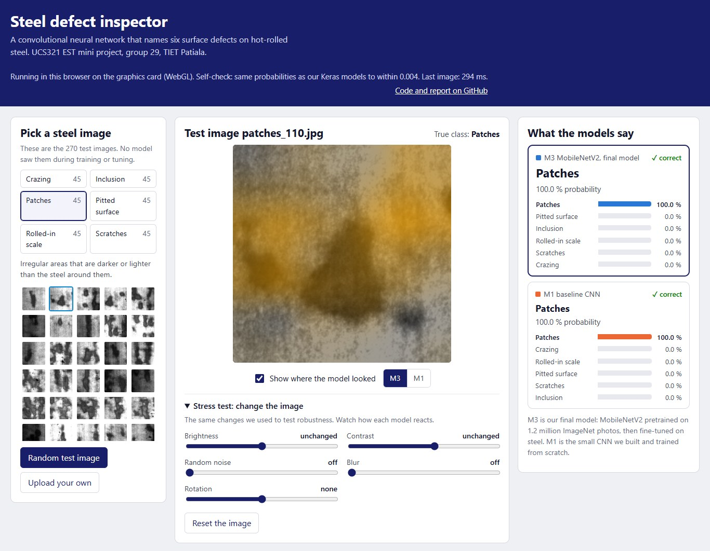
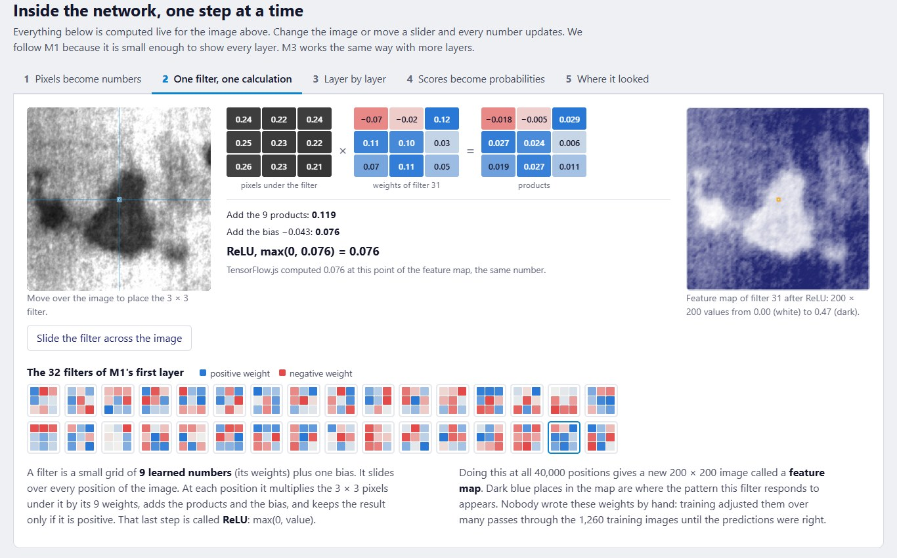
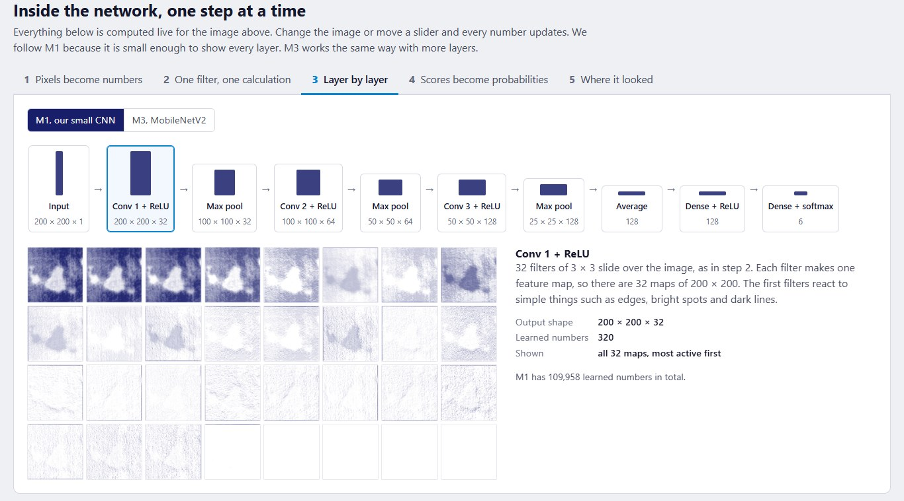
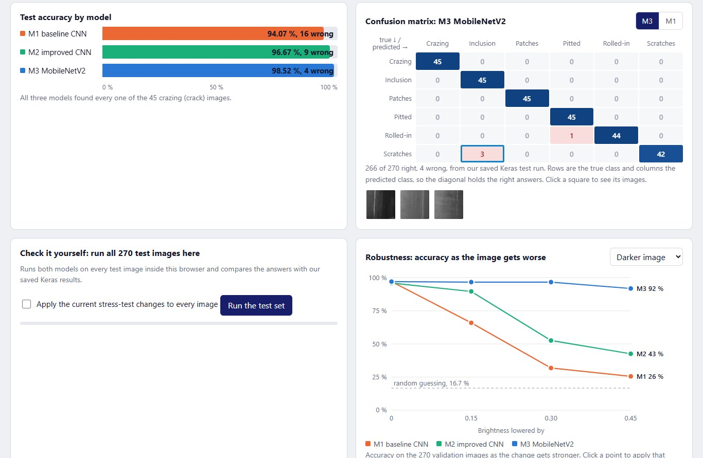
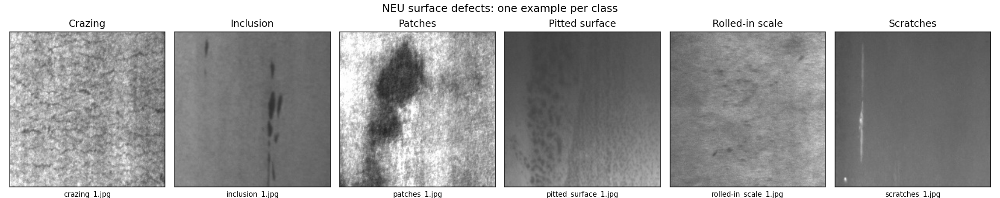

# Steel defect inspector

A convolutional neural network (CNN) that looks at a grayscale photo of hot-rolled steel strip and names which of six surface defects it shows. It comes with a demo that runs in the browser and shows, step by step, how the network reaches its answer.

UCS321 AI for Engineers, EST mini project, statement #3 (Tata Steel scenario). TIET Patiala, B.E. ECE, Semester III, group 29.



| Result | Value |
|---|---|
| **Best model** | MobileNetV2, fine-tuned on steel |
| **Test accuracy** | **98.52 %** (266 of 270 test images right) |
| **Cracks found** | 45 of 45 crazing images (recall 100 %) |
| **Small enough to deploy** | 2.51 MB as TensorFlow Lite, 18 ms per image on a laptop CPU |
| **Demo** | One HTML file that works offline with nothing to install |

## Contents

- [Open the demo](#open-the-demo)
- [What the demo shows](#what-the-demo-shows)
- [A five-minute demo script](#a-five-minute-demo-script)
- [The dataset](#the-dataset)
- [Results](#results)
- [How the browser demo works](#how-the-browser-demo-works)
- [Run the notebooks and the Streamlit app](#run-the-notebooks-and-the-streamlit-app)
- [Project folders](#project-folders)
- [Team](#team)

## Open the demo

The whole demo is one file, `demo/index.html` (16 MB). It carries both models, all 270 test images and our saved results inside it, so it needs no Python and no internet connection.

**1. Get the code.** Clone it:

```bash
git clone https://github.com/ArnavCodez/Ai-for-engineers-EST-project.git
```

```bash
cd Ai-for-engineers-EST-project
```

Or, without git: on the GitHub page press **Code**, then **Download ZIP**, and unzip it.

**2. Open the page.**

On **Windows**, double-click `demo\index.html` in File Explorer, or run this in Command Prompt or PowerShell:

```bash
start demo\index.html
```

On **macOS**, double-click `demo/index.html` in Finder, or run this in Terminal:

```bash
open demo/index.html
```

On **Linux**, open the file from your file manager, or run:

```bash
xdg-open demo/index.html
```

**Browser.** We tested it in Google Chrome. Microsoft Edge uses the same engine. Firefox and Safari should work as long as WebGL is on, but we have not checked them. The page runs the models on the graphics card through WebGL and switches to the processor by itself if the graphics card gives wrong numbers.

**First start.** The first time, the browser compiles its graphics programs, which can take 10 to 20 seconds. Later starts take about a second because the browser keeps them. When the page is ready, the line under the title says which chip it runs on and how close its answers are to our Keras models.

## What the demo shows

**The workspace (top of the page).**
- **Pick a steel image.** The 270 test images, 45 per class. No model saw them during training or tuning. A red dot marks the four images our final model got wrong. You can also upload your own picture; the page turns it gray and scales it to 200 × 200 px.
- **What the models say.** Our final model M3 (MobileNetV2) and our from-scratch CNN M1 answer side by side, each with the probability of all six classes.
- **Show where the model looked.** A Grad-CAM heat map over the image. The amber areas are the ones that pushed the model towards its answer.
- **Stress test.** Sliders for brightness, contrast, noise, blur and rotation. Both models rerun as you drag, so you can watch M1 break while M3 holds.

**Inside the network, one step at a time.** Five steps that follow the picture through the network with the real numbers.

1. **Pixels become numbers.** Zoom into a 9 × 9 patch and see the gray values the model receives.
2. **One filter, one calculation.** Pick any of M1's 32 first-layer filters. The page shows a 3 × 3 patch of the image, the filter's 9 weights and the multiply-and-add that gives one output number. Press *Slide the filter across the image* to watch it build the whole feature map.

   

3. **Layer by layer.** Every stage of M1 or M3 with its output shape, parameter count and feature maps, from the input image down to six scores.

   

4. **Scores become probabilities.** The six raw scores, the softmax formula and the probabilities it gives, with the real values.
5. **Where it looked.** Grad-CAM for both models next to each other, with an opacity slider.

**How well it works.** Test accuracy of all three models, confusion matrices you can click to see the images behind each square, the robustness charts from our notebooks (click a point to apply that change to the current image) and a button that reruns all 270 test images in the browser and compares every answer with our saved Keras results.



## A five-minute demo script

1. Open the page and point at the status line: the browser gives the same probabilities as our Keras models.
2. Click a few test images in different classes. Turn on *Show where the model looked* and note that the heat sits on the defect, not the background.
3. Open the **Crazing** tab and pick the fourth image in the first row (`crazing_125.jpg`; hover over a thumbnail to see its name). Open *Stress test* and drag **Brightness** to **−0.15**. M1 changes its answer to *Patches* at 100 %, while M3 stays on *Crazing* at 99.9 %. This is the robustness gap from our report in one image.
4. Press *Reset the image*, scroll to *Inside the network* and open step 2. Press *Slide the filter across the image* and explain one convolution.
5. Open step 4 and show how the six scores turn into probabilities.
6. Scroll to *How well it works* and press **Run the test set**. In about 15 seconds on our laptop it gets 98.52 % for M3 and 94.07 % for M1, the same as our test notebook, and every answer matches the saved Keras run.

## The dataset



We use the **NEU surface defect database** from Northeastern University, China (Song and Yan, 2013), through its [Kaggle mirror](https://www.kaggle.com/datasets/kaustubhdikshit/neu-surface-defect-database).

- **1,800 grayscale images** of hot-rolled steel strip, **200 × 200 px**.
- **6 classes, 300 images each**, so the classes are balanced.
- We only use each image and its class. The mirror also has bounding boxes for object detection, which we ignore.

| Class | What it looks like |
|---|---|
| Crazing | A network of fine cracks in the surface. This is our crack class. |
| Inclusion | Bits of non-metal material pressed into the steel. |
| Patches | Irregular areas that are darker or lighter than the steel around them. |
| Pitted surface | Small pits and craters scattered over the surface. |
| Rolled-in scale | Oxide scale that was pressed into the strip during rolling. |
| Scratches | Long thin scratch lines on the surface. |

**Our split.** We split the images once, before training, with a fixed seed (42) and the same share of every class in each part:

| Part | Images | Per class | Used for |
|---|---|---|---|
| Train | 1,260 | 210 | Fitting the weights |
| Validation | 270 | 45 | Choosing models, epochs and settings |
| Test | 270 | 45 | The final score, opened once |

The test set was opened a single time, after we had picked our finalists on the validation set, so the test score is not tuned to it. The lists of files are in `data/splits/`. How to get the images is in [`data/README.md`](data/README.md).

## Results

We trained three models and scored all of them on the test set in one pass.

| Model | What it is | Test accuracy | Wrong of 270 | Macro F1 | Crack recall | Parameters | Size |
|---|---|---|---|---|---|---|---|
| M1 | Our CNN from scratch: 3 conv blocks (32, 64, 128 filters), global average pooling, dense 128, softmax | 94.07 % | 16 | 0.940 | 100 % | 110 k | 1.4 MB |
| M2 | M1 plus batch normalisation and data augmentation (flips, small rotations, zoom, brightness and contrast changes) | 96.67 % | 9 | 0.967 | 100 % | 111 k | 1.4 MB |
| **M3** | **MobileNetV2 pretrained on ImageNet, then fine-tuned on steel** | **98.52 %** | **4** | **0.985** | **100 %** | 2.27 M | 24.5 MB |

- **Final model: M3.** Its four mistakes are three scratches it called inclusion and one rolled-in scale it called pitted surface.
- **Every model found every crack.** All 45 crazing images were caught by M1, M2 and M3.
- **Robustness.** On the validation images made darker by 0.45, M3 still gets 92 % right while M1 drops to 26 %. M3, pretrained on 1.2 million photos, copes far better with changes in lighting, noise and blur.
- **Small enough for the factory floor.** As TensorFlow Lite, M3 shrinks from 24.5 MB to 2.51 MB and takes 18 ms per image on a laptop CPU, with the same answer as the Keras model on 99.6 % of validation images.

The full numbers are in `outputs/results/` (for example `test_metrics.csv`, `robustness.csv` and `tflite.csv`), the figures in `outputs/figures/`, and the write-up in [`docs/report/report.pdf`](docs/report/report.pdf).

## How the browser demo works

- **TensorFlow.js in the page.** The models run on TensorFlow.js 4.22.0 (Apache 2.0 licence), which is stored inside the HTML file, so nothing is downloaded.
- **Our own weights.** `demo/build_demo.py` reads the trained Keras models and writes their weights into the page. For M3 it folds every batch normalisation layer into the convolution before it and stores the weights as 16-bit numbers, which halves the file size. Before writing the page it checks that this version gives the same class as Keras on all 270 test images.
- **Same preprocessing as the notebooks.** M1 gets the 200 × 200 image scaled to 0 to 1. M3 gets it resized to 224 × 224, copied into three channels and scaled to −1 to 1. The test images are stored as lossless PNGs of exactly the pixels TensorFlow decoded, because browsers decode the original JPEG files to slightly different gray values.
- **Checks itself.** On start the page runs three test images through both models and compares the probabilities with the ones Keras gave. If they disagree it retries and then falls back to the processor.
- **Grad-CAM.** The heat maps come from the last convolution layer of each model, weighted by how much each feature map raises the predicted class.

To rebuild the page after changing anything in `demo/src/`, you need the trained models in `outputs/models/` and the images in `data/raw/NEU-DET/` (see the next section). Then, from the project folder with the virtual environment active:

```bash
python demo/build_demo.py
```

It takes about a minute and a half and rewrites `demo/index.html`. Never edit that file by hand.

## Run the notebooks and the Streamlit app

You only need this to retrain the models or run the older Streamlit demo. The browser demo above needs none of it.

**What is not in git.** We keep the images (`data/raw/NEU-DET/`) and the trained models (`outputs/models/`) out of git. Both are in our submission zip. Without the zip, download the dataset from the [Kaggle mirror](https://www.kaggle.com/datasets/kaustubhdikshit/neu-surface-defect-database), unzip it so that `data/raw/NEU-DET/` exists. Then run notebooks 04 and 05 to train the models again.

**Python.** We used Python 3.11 on the laptop and Python 3.13 on Kaggle. The package versions are pinned in `requirements.txt`.

### Windows

Make the virtual environment and install the packages (first time only):

```bash
py -m venv .venv
```

```bash
.venv\Scripts\activate
```

```bash
pip install -r requirements.txt
```

Start the Streamlit app:

```bash
streamlit run app.py
```

If PowerShell refuses to run the activate script, use Command Prompt, or skip activating and run `.venv\Scripts\python -m streamlit run app.py`.

Or double-click `run_demo.bat`, which does all of the above on the first run and opens the app at http://localhost:8502.

### macOS and Linux

On Debian or Ubuntu, install `python3-venv` first if the first command fails.

```bash
python3 -m venv .venv
```

```bash
source .venv/bin/activate
```

```bash
pip install -r requirements.txt
```

```bash
streamlit run app.py
```

The app opens at http://localhost:8501. It has two tabs: *Classify an image* (pick or upload an image, change it with sliders, see M1 and M3) and *Model performance* (all the tables and charts from `outputs/results/`).

### The notebooks

With the virtual environment active:

```bash
jupyter notebook notebooks/
```

| Notebook | What it does |
|---|---|
| `01_data_check` | Checks every image (size, colour mode, duplicates) and lists them in `data/all_images.csv` |
| `02_split_and_eda` | Makes the train, validation and test split and the data exploration figures |
| `03_pipeline_and_augmentation` | The loading pipeline and the augmentation layers |
| `04_cnn_from_scratch` | Trains M1 and M2 |
| `05_transfer_learning` | Trains M3 and compares all three on validation |
| `06_evaluation` | Scores the models on the test set, once |
| `07_extras` | Grad-CAM, robustness, augmentation ablation and TensorFlow Lite |

We ran them on **Kaggle** with a free GPU; training M3 on a laptop CPU is slow. To run one on Kaggle from this folder and copy its results back:

```bash
python kaggle/run_on_kaggle.py 01_data_check
```

This needs the Kaggle CLI (`pip install kaggle`), signed in once with `kaggle auth login`. The settings for each notebook are in `kaggle/kernels.json`.

## Project folders

```
demo/         index.html (the browser demo), build_demo.py, src/ (page source), vendor/ (TensorFlow.js)
notebooks/    01 to 07, in the order above
data/         README (source), all_images.csv, splits/ (raw images are not in git)
outputs/      figures/ (PNG), results/ (CSV, JSON), models/ (not in git)
docs/         problem.md, flow_diagram.md and .png, report/ (report.md and report.pdf), demo/ (screenshots)
kaggle/       run_on_kaggle.py and kernels.json
app.py        Streamlit demo (run_demo.bat starts it on Windows)
```

To learn the project from the start, read this README, then `PLAN.md`, `LOG.md` from top to bottom, `CONCEPTS.md` and `VIVA_QA.md`. The team rules (log format, test set used once, seed 42) are in `CONTRIBUTING.md`.

## Team

Group 29: Arnav Aggarwal, Armaan Malhotra, Tanishq Vashistha, Ishita Sharma and Abhilasha Das. UCS321 AI for Engineers, Thapar Institute of Engineering and Technology, Patiala.

## References

- K. Song and Y. Yan, "A noise robust method based on completed local binary patterns for hot-rolled steel strip surface defects," *Applied Surface Science*, vol. 285, pp. 858 to 864, 2013. (The NEU dataset.)
- M. Sandler, A. Howard, M. Zhu, A. Zhmoginov and L.-C. Chen, "MobileNetV2: Inverted Residuals and Linear Bottlenecks," *CVPR*, 2018.
- R. R. Selvaraju et al., "Grad-CAM: Visual Explanations from Deep Networks via Gradient-based Localization," *ICCV*, 2017.
- TensorFlow.js, https://www.tensorflow.org/js (Apache 2.0).
