

# ARTIFICIAL INTELLIGENCE FOR ENGINEERS (UCS321)

## EST PROJECT REPORT

# Steel Surface Defect Recognition with a Convolutional Neural Network

Thapar Institute of Engineering and Technology, Patiala

**Submitted by:**

Arnav Aggarwal (1025150338)
Armaan Malhotra (1025150339)
Tanishq Vashistha (1025150341)
Ishita Sharma (1025150345)
Abhilasha Das (1025150396)

**Submitted to:**

Dr. Jyoti Maggu

Code and notebooks: https://github.com/ArnavCodez/Ai-for-engineers-EST-project

## Abstract

Surface defects on hot-rolled steel strip lower product quality and get coils rejected, and checking the strip by eye is slow and tiring. The project follows a Tata Steel scenario: build a convolutional neural network (CNN) that recognises surface defects, cracks included, from images, so that defect counts can later point to faulty equipment.

Earlier work ranges from manual inspection to hand-designed texture features such as completed local binary patterns and, more recently, CNNs trained with transfer learning on small defect sets. A high score on one benchmark split says little about how a model would cope in a real plant or what it actually looks at. Most of our effort therefore went into the evaluation. We split the data before exploring it, opened the test set once and added tests of robustness, explanation and model size.

The data is the public NEU surface defect database: 1,800 grayscale images of 200 x 200 pixels, 300 in each of six classes. Crazing, a network of fine surface cracks, is our crack class. We split the images into 1,260 for training, 270 for validation and 270 for testing, keeping one duplicate pair together. Three CNNs were compared: a small CNN with 109,958 parameters (M1), the same network with batch normalisation and augmentation (M2) and MobileNetV2 pretrained on ImageNet and fine-tuned (M3). Along the way we had to find and fix two batch-normalisation bugs.

On the test set M3 reached 98.52% accuracy (4 errors in 270 images) and a macro F1 of 0.9852, and it found all 45 crazing images without a single false crack alarm. M1 had tied M3 at 97.04% on validation but managed only 94.07% on test, and its Grad-CAM heatmaps often sit on the background. With the images made 0.45 darker, M3 still scored 91.85% on validation while M1 dropped to 25.56%. Gaussian noise with a standard deviation of 0.10 broke every model. Converted to TensorFlow Lite, M3 shrinks from 24.46 MB to 2.51 MB and needs 18.03 ms per image on a CPU.

NEU is a single, clean, lab-style dataset, so none of this shows yet how the model would do on a production line.

## 1. Introduction

### 1.1 Background and problem overview

Hot-rolled strip starts as a slab heated to roughly 1100 to 1250 °C. Water sprays knock off the oxide layer that forms on the hot surface, a series of rolling mills squeezes the slab thinner and a coiler winds up the finished strip [1]. Defects can enter at several of these steps. Casting can leave non-metallic inclusions in the steel, weak descaling presses scale into the surface and debris or a badly set roll gap scratches it [2].

A surface defect makes the product look worse and can lower its fatigue resistance, which is how well it survives repeated loading [3]. Defects also mean unhappy customers and lost money [4]. Visual checking is slow, depends on the inspector's experience and misses defects once the inspector gets tired [4]. On top of that the strip moves fast; one article on a hot strip mill quotes speeds of up to 15 m/s [5].

Our problem statement is set at Tata Steel. It asks for a CNN-based image recognition system that finds surface cracks in steel plates from high-resolution images, to support predictive maintenance and cut defects in production. We treat this as image classification: the model takes a grayscale image of the steel surface and returns one of six defect classes. As a formula:

predicted class = f(image)

where f is the trained CNN. All images come from the public NEU surface defect database; we had no Tata Steel data.

Predictive maintenance means fixing equipment before it fails, based on early warning signs. A classifier that counts defect types over time can give such signs, because a rising count points at one part of the line. More rolled-in scale suggests looking at the descaling system, and more scratches suggest looking at the rolls and the roll gap [2]. One defect type can have several causes, though, and root-cause analysis often goes wrong [6]. A rising count tells the crew where to look, and the inspection itself has to find the cause. We did not build a trend dashboard, and NEU has no timestamps to test one with. Our model would supply the labels for it.

### 1.2 Literature review and research gap

Manual inspection is the oldest approach, with the limits described above [4]. Machine vision replaced the eye with a camera. Line-scan cameras build the image one row of pixels at a time as the strip passes underneath, which suits a fast-moving strip [5]. Early methods computed hand-designed texture features from these images. Song and Yan, who also published the NEU database we use, proposed a noise-robust method for hot-rolled strip defects based on completed local binary patterns [7]. Newer work uses CNNs: one study classifies steel sheet defects with a NasNet-Mobile network trained on few samples [3], and another compares object detection algorithms for surface defects [4]. With small defect datasets the common approach is transfer learning, where a network pretrained on a large photo collection is adapted to the new task. MobileNetV2 is a small network of this kind, designed for mobile devices [9], and we fine-tuned it the way the Keras guide on transfer learning describes [10].

A benchmark accuracy leaves some practical questions open. Was it measured honestly, with no image in both training and test and with the test set kept out of every design decision? Does the model look at the defect, or at something in the background that happens to go with the class? Would it cope with a dirty lens, blur or weaker lights, and is it small enough for a computer next to the line? NEU images are clean and balanced, so a high accuracy is expected and can hide trouble on any of these points.

We look at these questions on one dataset and with existing architectures. Three CNNs are compared under a strict evaluation protocol. Grad-CAM heatmaps show what each model uses, damaged images test its robustness, an ablation measures what augmentation is worth and a TensorFlow Lite conversion gives the model's size and speed on a CPU. We also report two mistakes we made with batch normalisation, since both changed the results.

### 1.3 Objectives

1. Data check: confirm the size, format, class counts and duplicates of the dataset before using it.
2. Split and exploration: split the data first, then study the training images only, to learn what separates the six defects.
3. Pre-processing: build a loading pipeline and a set of augmentations that make physical sense for a steel strip.
4. Model development: train and compare CNNs of our own and a pretrained MobileNetV2.
5. Evaluation: measure accuracy and macro F1 on a test set opened once, and report precision, recall and F1 for cracks (the crazing class) against the other five classes.
6. Interpretation and extras: show where the models look (Grad-CAM), how they behave on damaged images, what augmentation is worth and how small and fast the model can get.

We did not fix numeric targets for these measures before training. The success criteria we agreed on were macro F1, recall on cracks (a missed crack reaches the customer, while a false alarm only costs a re-check), time per image and model size.

### 1.4 Expected outcomes

The expected result is a working pipeline from raw images to a trained classifier, a comparison of three CNNs and per-class results that show which defects get mixed up. Accuracy should be high because NEU is a clean benchmark, so we planned tests of how much of it survives when the images get worse. The recogniser is meant for study and as a starting point for an inspection aid. Using it on a real line would need the plant's own labelled images.

## 2. Methodology

### 2.1 Dataset description and source

The NEU surface defect database comes from Northeastern University, China, and holds 1,800 grayscale images of hot-rolled steel strip, 300 for each of six defect classes [7]. We took it from a Kaggle mirror [8] in the NEU-DET layout, which has train and validation folders and XML box annotations for object detection. Only the image and its class are needed here, and the class is the first part of the file name. We ignored the mirror's own folders (1,440 and 360 images) and the 1,800 XML files and made our own split.

Table 1 summarises what our data check (notebook 01) found.

*Table 1. Dataset summary.*

| Item | Value |
|---|---|
| Source | NEU surface defect database, Kaggle mirror kaustubhdikshit/neu-surface-defect-database [8] |
| Images | 1,800 (6 classes x 300) |
| Classes | crazing, inclusion, patches, pitted surface, rolled-in scale, scratches |
| Size and format | 200 x 200 px, JPEG |
| Colour mode | stored as RGB, but the three channels are identical in all 1,800 images, so the images are grayscale |
| Exact duplicates | 1 pair: patches_101.jpg and patches_105.jpg (byte-identical, same class) |

Our sources describe crazing as a network of fine surface cracks, inclusion as foreign material in the surface, patches as irregular blotchy areas, pitted surface as small pits, rolled-in scale as oxide pressed into the surface and scratches as linear marks from abrasion [4][7]. Rolled-in scale and crazing can look alike [4]. We found no source on what causes crazing or patches, so the report makes no claim about their causes.

The problem statement asks for surface cracks, while NEU has six defect classes, of which crazing is the crack-like one. We train one CNN on all six classes, which keeps all the data, and report precision, recall and F1 for crazing against the other five. These are the crack metrics used throughout the report.

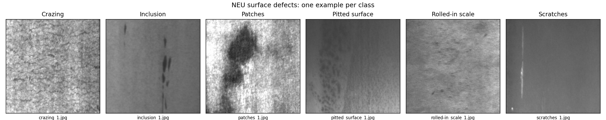

*Figure 1. The first image of each class by file name: crazing, inclusion, patches, pitted surface, rolled-in scale and scratches. The defects already look different: dark blobs for patches, a bright line for scratches, small dark marks for inclusion.*

At 200 x 200 px the NEU images are small. A line-scan camera produces long high-resolution images, and a real system would cut them into tiles and classify each tile. That is our own reading of how NEU relates to a production line. We found no source saying the NEU images are crops of line-scan output, and we did not build the tiling step.

### 2.2 Data preprocessing

#### Splitting before exploring

The original plan put exploratory data analysis (EDA) first. We moved the split in front of it so that no design choice could depend on the test images. The split is stratified 70/15/15 with seed 42, meaning each class keeps the same share in every part. It works on groups of identical pixels, so the duplicate pair always lands in the same part, and an assertion checks that no picture appears in two parts. A second run of the notebook produced byte-identical split files.

*Table 2. Images per class in each part of the split.*

| Class | Train | Validation | Test |
|---|---|---|---|
| Crazing | 210 | 45 | 45 |
| Inclusion | 210 | 45 | 45 |
| Patches | 210 | 45 | 45 |
| Pitted surface | 210 | 45 | 45 |
| Rolled-in scale | 210 | 45 | 45 |
| Scratches | 210 | 45 | 45 |
| Total | 1,260 | 270 | 270 |

#### Exploratory data analysis

We made six plots of the 1,260 training images: class balance, a grid of samples, the mean image per class, pixel histograms, brightness and contrast boxplots and a PCA of raw pixels. They showed the following.

- The classes are balanced, so accuracy is a fair first metric.
- Brightness alone cannot separate the classes. Median brightness runs from 90.36 (scratches) to 186.05 (pitted surface), but the ranges overlap.
- Patches stand out by their contrast, with a median pixel standard deviation of 57.75 against 11.18 to 28.55 for the other classes.
- Patches and pitted surface have a spike at pixel value 255, so some of their images are over-exposed.
- The lighting is uneven. The mean images of crazing, inclusion, pitted surface and scratches get darker towards the right edge, an effect of the camera and lights that a model should not learn.
- The mean image of scratches shows both vertical and horizontal lines, so scratches run in both directions.
- In raw pixel space the first principal component holds 70.63% of the variance and is simply overall brightness (correlation 1.0). The second holds 8.28%. Crazing, inclusion and rolled-in scale overlap in the middle of the plot.

The PCA result is the argument for using a CNN. The biggest difference between raw images is their brightness, which says nothing about the defect. Two overlapping components cannot prove that the classes are inseparable, but they do suggest that raw pixels represent the defects poorly.

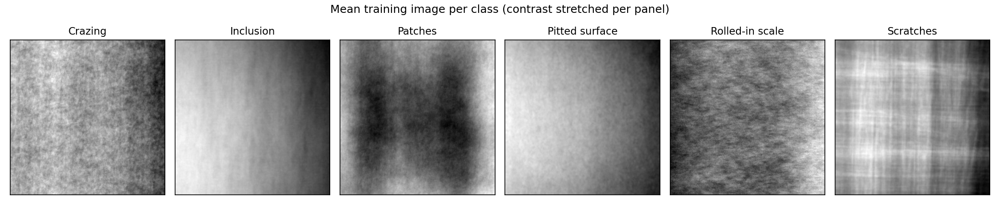

*Figure 2. Mean training image per class. Four of the six means get darker towards the right edge (uneven lighting), the scratches mean shows lines in both directions and the patches mean shows dark blobs near the centre.*

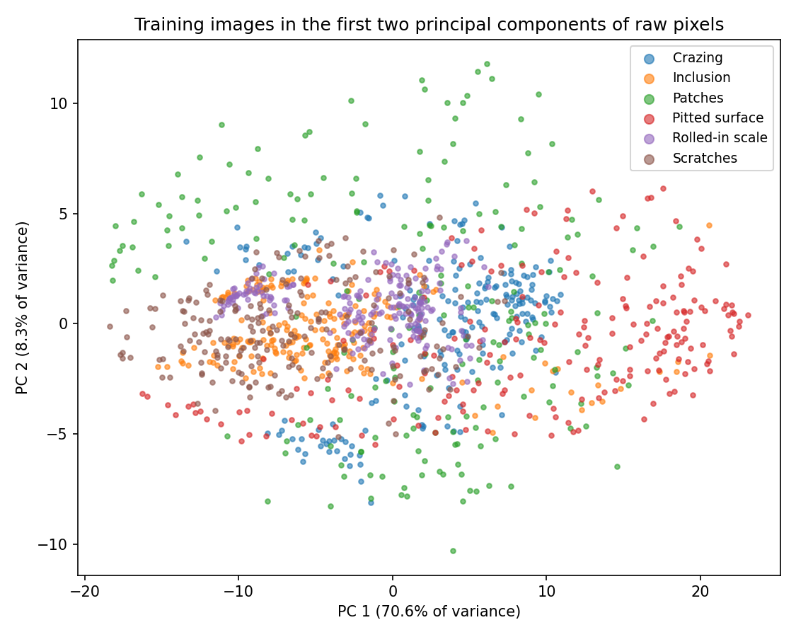

*Figure 3. PCA of the training images shrunk to 50 x 50 px. The first component is overall brightness. The classes overlap, so raw pixels do not separate them.*

#### Loading pipeline

A `tf.data` pipeline reads each file, decodes it as one grayscale channel, resizes it and groups the images into batches of 32. Our own CNNs take 200 x 200 x 1 images with pixels scaled to 0 to 1. MobileNetV2 takes 224 x 224 x 3 images, with the grayscale channel repeated three times and scaled to -1 to 1 by its own `preprocess_input`. Getting this range wrong for a pretrained network raises no error; the model simply trains badly. We checked the batches (32 x 200 x 200 x 1 with values 0.0 to 1.0, and 32 x 224 x 224 x 3 with values -0.997 to 1.0), and both first batches contained all six classes.

#### Augmentation

With only 210 training images per class a network can memorise its training set. Augmentation counters this by showing it a slightly different version of every image in each epoch. We picked five layers that make sense for a camera above a steel strip: horizontal and vertical flips, rotation by up to 5% of a turn either way (about 18 degrees), zoom up to 10% and changes of up to 20% in contrast and brightness. The flips follow from the EDA findings on uneven lighting and scratch direction. We left out 90 degree turns, since scratches and rolled-in scale follow the rolling direction, and colour jitter, which means nothing for grayscale images. Rotated corners are filled by reflecting the image, because black triangles would never appear on a real strip. The layers sit inside the model and Keras applies them only during training, so validation and test images are never augmented.

Before training we went through a leakage checklist: the split was made before any augmentation, validation and test images are never augmented, no picture is in two parts and the test set had not been used for any decision.

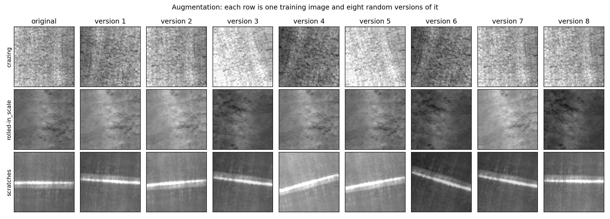

*Figure 4. One training image each of crazing, rolled-in scale and scratches, with eight random augmented versions of each. The augmented images still look like real steel.*

### 2.3 Flow chart

Figure 5 shows the workflow in four blocks: the data, visualisation with pre-processing, modelling and finally evaluation with the extras. A dotted arrow marks where the EDA findings led to the choice of flips.

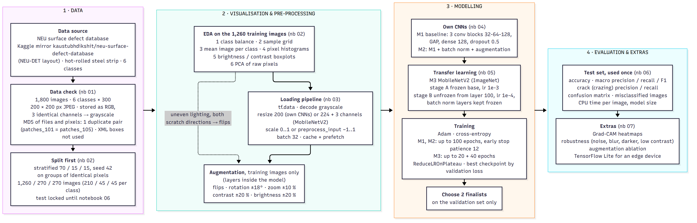

*Figure 5. Project flow chart, from the data check to the extras.*

### 2.4 Model architectures

All models are trained with Adam and sparse categorical cross-entropy, a loss that is small when the model gives a high probability to the true class.

#### M1: baseline CNN without augmentation

M1 has three convolution blocks. In each block a 3 x 3 convolution with ReLU slides small filters over the image and responds to edges and textures, and 2 x 2 max pooling then halves the image size while keeping the strongest response. The number of filters grows from 32 to 64 to 128 as the image shrinks, so later layers see larger patterns. Global average pooling turns each of the 128 feature maps into one number, and a dense layer of 128 ReLU units, dropout of 0.5 and a 6-way softmax give the class probabilities. The model has 109,958 parameters and a 1.38 MB file.

#### M2: improved CNN

M2 is the same network with batch normalisation after each convolution plus the augmentation layers from Section 2.2. Batch normalisation rescales the activations of each batch, which steadies training. At prediction time it uses running averages collected during training instead, and Keras updates those averages with a momentum of 0.99 by default. For M2 we had to lower this to 0.9 (Section 3.5). M2 has 110,630 parameters and a 1.41 MB file.

#### M3: MobileNetV2 with transfer learning

MobileNetV2 is a small network for mobile devices built from depthwise convolutions and inverted residual blocks [9]. We load its ImageNet weights and add a head made of global average pooling, dropout of 0.3 and a 6-way dense layer. Training then runs in two stages:

- Stage A: the base is frozen and only the head learns, with learning rate 1e-3, for up to 20 epochs.
- Stage B (fine-tuning): the base is unfrozen from layer 100 (its last six blocks, about a third of its layers) and training continues at learning rate 1e-4 for up to 40 epochs. Every batch-normalisation layer of the base stays frozen, and the base is called with `training=False`.

Keeping the batch-normalisation layers frozen was our fix for a bug described in Section 3.5. M3 has 2,265,670 parameters and a 24.46 MB file.

## 3. Experiments and Results

### 3.1 Experimental setup

*Table 3. Experimental setup.*

| Parameter | Configuration |
|---|---|
| Task | 6-class image classification, plus crack (crazing) versus rest metrics |
| Framework | TensorFlow 2.20.0 with Keras, Python 3.13.15, NumPy 2.1.3, pandas 2.3.3 |
| Hardware | Kaggle notebooks with a Tesla T4 GPU |
| Random seed | 42 |
| Data | 1,260 training, 270 validation, 270 test images |
| Batch size | 32 |
| Optimiser, loss | Adam, sparse categorical cross-entropy |
| M1 and M2 training | learning rate 1e-3, up to 100 epochs, early stopping on validation loss with patience 12, learning rate halved after 4 epochs without improvement |
| M3 training | stage A lr 1e-3 (up to 20 epochs, patience 5), stage B lr 1e-4 (up to 40 epochs, patience 8), batch normalisation frozen |
| Checkpoint | weights of the epoch with the lowest validation loss |

All notebooks ran on Kaggle with the NEU mirror attached, and the repository keeps the exact library versions of that run. There are seven notebooks: data check, split and EDA, pipeline and augmentation, own CNNs, transfer learning, evaluation and extras. For our own CNNs we raised the early-stopping patience from 8 to 12, because M2's validation curve is jumpy and training kept stopping before the learning-rate cuts could settle it.

### 3.2 Comparison method

M1, M2 and M3 see identical data and the same split. M1 is the simplest CNN we can explain layer by layer, M2 adds batch normalisation and augmentation and M3 tests what a pretrained network brings. Since M2 differs from M1 in two ways at once, a gap between them cannot be credited to either change alone. The comparison covers CNNs only; we did not include a non-neural baseline.

### 3.3 Evaluation protocol

The protocol was fixed before training:

1. All model choices (architecture, learning rates, epochs, which models are finalists) use the validation set only.
2. Two finalists were chosen on validation: M3, which had the lowest validation loss, and M1, the best of our own CNNs with a file about 18 times smaller. We logged this decision before going further.
3. The test set (270 images, 45 per class) was opened once, at 04:38:53 UTC on 18 October 2026 (10:08:53 IST), about two minutes after the finalists were logged. All three models were scored in that single pass so that the comparison table is complete, but only the finalists count as our reported result. Nothing was changed afterwards.
4. The extra experiments that damage images or retrain models (robustness, ablation) use the validation set, so the test set stays a one-time measurement.

*Accuracy* is the share of images classified correctly. *Precision* for a class is the share of images predicted as that class that truly belong to it. *Recall* is the share of true images of that class that the model found. *F1* is the harmonic mean of the two:

F1 = 2 x precision x recall / (precision + recall)

*Macro* averages are computed per class and then averaged, so every class counts the same. The crack metrics are precision, recall and F1 for crazing against the other five classes. Recall is the one we care about most, because a missed crack reaches the customer. CPU time per image is the mean of 100 single-image calls on the CPU after 10 warm-up calls, and model size is the size of the saved file.

With 270 images in a set, a single image is worth 0.37 percentage points. Validation scores are also a little optimistic, because the validation set was used to compare models, to stop training and to settle the fine-tuning recipe (three tries, Section 3.5). Each model was trained once, so there are no standard deviations to report.

### 3.4 Quantitative results

#### Validation results

*Table 4. Validation results (270 images). Epochs shows epochs trained and, in brackets, the best epoch. For M3 the 29 epochs are 15 in stage A and 14 in stage B.*

| Model | Val. accuracy | Val. loss | Parameters | File size | Epochs (best) | Train time |
|---|---|---|---|---|---|---|
| M1 baseline CNN | 97.04% | 0.1056 | 109,958 | 1.38 MB | 100 (100) | 182.1 s |
| M2 + batch norm + augmentation | 95.93% | 0.1310 | 110,630 | 1.41 MB | 41 (29) | 158.6 s |
| M3 MobileNetV2 | 97.04% | 0.0832 | 2,265,670 | 24.46 MB | 29 (21) | 121.2 s |

M1 and M3 tie on validation accuracy. We chose M3 because it has the lowest validation loss, 0.0832 against 0.1056 for M1 and 0.1310 for M2. M1 shows no sign of overfitting: its training accuracy, measured with dropout on, stayed below its validation accuracy in 91 of 100 epochs, and it was still improving slowly when it hit the 100-epoch limit. M2 scored 95.93%, three validation images fewer than M1, so on this small, clean dataset batch normalisation and augmentation did not beat a tiny CNN that already has dropout and global average pooling. M2's validation curve is jumpy, and even after epoch 10 its accuracy swings between 72.6% and 96.3%. With frozen ImageNet features alone (stage A) M3 peaked at 81.11%, so the fine-tuning matters a lot for steel textures.

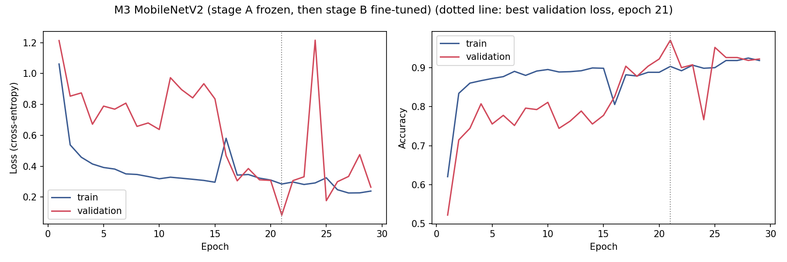

*Figure 6. Training curves of M3. Stage A covers epochs 1 to 15 and stage B epochs 16 to 29. The dotted line marks the epoch with the lowest validation loss (21). The validation curve is jumpy, as expected with 270 images. Training accuracy is measured with dropout on, so it can sit below validation accuracy.*

#### Test results

*Table 5. Test results (270 images, opened once). Crack metrics are for the crazing class against the other five. M2 was not a finalist.*

| Model | Accuracy | Macro F1 | Crack precision | Crack recall | Crack F1 | Errors | CPU ms per image | File size |
|---|---|---|---|---|---|---|---|---|
| M3 MobileNetV2 (finalist, final model) | 98.52% | 0.9852 | 1.0000 | 1.0000 | 1.0000 | 4 | 223.96 | 24.46 MB |
| M1 baseline CNN (finalist) | 94.07% | 0.9400 | 0.9783 | 1.0000 | 0.9890 | 16 | 21.57 | 1.38 MB |
| M2 improved CNN (not a finalist) | 96.67% | 0.9665 | 0.9375 | 1.0000 | 0.9677 | 9 | 29.31 | 1.41 MB |

M3 is our final model, with 98.52% accuracy, 4 errors in 270 images, a macro precision of 0.9860 and a macro recall of 0.9852. Every model found all 45 crazing test images, so crack recall is 100% for all three. M3 raised no false crack alarm, while M1 called one patches image crazing (crack precision 0.9783).

M1 dropped from 97.04% on validation to 94.07% on test while M2 rose from 95.93% to 96.67%, the reverse of the validation ranking. A validation set of 270 images could not separate models this close. We kept the finalists chosen before the test set was opened and did not switch to M2. M3 did beat M1 on test accuracy, as its lower validation loss had suggested. The gap between M1 and M2 comes from a single run of each and is not a reliable verdict.

Speed and size differ a lot. On Kaggle's CPU one image takes 21.57 ms with M1 and 223.96 ms with M3, about 10 times longer, and M3's file is about 18 times larger. M3 is the more accurate model and M1 the one for a very small computer. A laptop or an edge board will give different times.

#### Robustness

A steel plant is hot, steamy and dusty, and its lights age. We damaged the validation images in four ways, each at three strengths, and measured accuracy again. M2 was included too, as the one CNN trained with brightness and contrast augmentation. Table 6 lists validation accuracy in percent from the mildest to the strongest damage. On clean images the scores are M1 97.04, M2 95.93 and M3 97.04.

*Table 6. Validation accuracy (%) under damage, at three strengths from mild to strong.*

| Damage (strengths) | M1 | M2 | M3 |
|---|---|---|---|
| Gaussian noise (std 0.02 / 0.05 / 0.10 on a 0 to 1 scale) | 58.2 / 29.3 / 24.4 | 46.3 / 31.1 / 25.2 | 96.3 / 82.6 / 48.1 |
| Gaussian blur (kernel 3 / 5 / 9 px) | 38.5 / 32.6 / 25.6 | 72.2 / 47.4 / 38.5 | 95.9 / 92.6 / 84.8 |
| Darker (by 0.15 / 0.30 / 0.45) | 65.9 / 31.9 / 25.6 | 89.6 / 52.6 / 42.6 | 96.7 / 96.7 / 91.9 |
| Low contrast (x 0.8 / 0.6 / 0.4) | 80.0 / 38.1 / 24.8 | 97.8 / 94.1 / 52.6 | 95.9 / 87.0 / 65.2 |

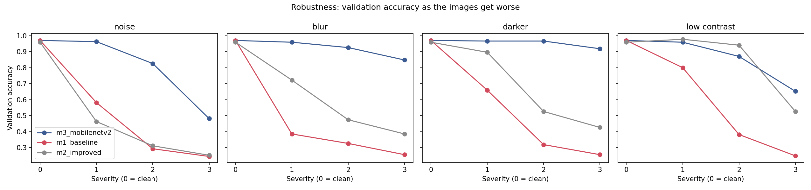

*Figure 7. Validation accuracy of M3, M1 and M2 as the images get worse (severity 0 is the clean image). Run on validation images only.*

MobileNetV2 holds up best, with 92.6% under a 5 px blur and 91.9% with the image 0.45 darker. M1 falls apart quickly: 65.9% at the first darkening step, 38.5% with a 3 px blur and 58.2% with slight noise. M2 copes with lighting changes far better than M1 (89.6% against 65.9% one step darker, 94.1% against 38.1% at contrast x 0.6) but does no better under noise. Strong noise with a standard deviation of 0.10 hurts every model and takes M3 down to 48.1%. None of our augmentations adds noise.

#### TensorFlow Lite

TensorFlow Lite turns a Keras model into a compact file for small boards. We used dynamic-range quantisation, which stores the weights as 8-bit integers instead of 32-bit floats. The first conversion of MobileNetV2 failed because the augmentation layers contain random operations that TensorFlow Lite cannot convert, so we converted an inference copy of each model without the augmentation block. Those layers do nothing at prediction time anyway.

*Table 7. TensorFlow Lite conversion, checked on the validation set.*

| Model | Keras size | TFLite size | Keras val. accuracy | TFLite val. accuracy | Same answer as Keras | TFLite CPU ms per image |
|---|---|---|---|---|---|---|
| M3 MobileNetV2 | 24.46 MB | 2.51 MB | 97.04% | 97.41% | 99.63% | 18.03 |
| M1 baseline CNN | 1.38 MB | 0.12 MB | 97.04% | 97.04% | 100% | 10.14 |

M3 shrinks about ten times to 2.51 MB and needs 18.03 ms per image on Kaggle's CPU, compared with 223.96 ms for the Keras model in the test notebook. M1 shrinks to 0.12 MB and needs 10.14 ms against 21.57 ms. The two sets of timings come from different notebooks on the same kind of CPU, so the speed-up ratios are approximate. On one of the 270 validation images the TensorFlow Lite version of M3 gave a different answer from the Keras model, and that answer happened to be right. We put this down to quantisation noise. Neither model has been run on an actual edge board yet.

### 3.5 Qualitative results

#### Where the models look

Grad-CAM asks how much the score of the predicted class would change if part of the last convolution layer's output changed [11], and regions with a large effect light up on the heatmap. We implemented it by hand with `tf.GradientTape`. For M1 we used the last ReLU before pooling and for M3 the output of the pretrained base (7 x 7 cells, 1,280 channels), with two validation images per class for each finalist.

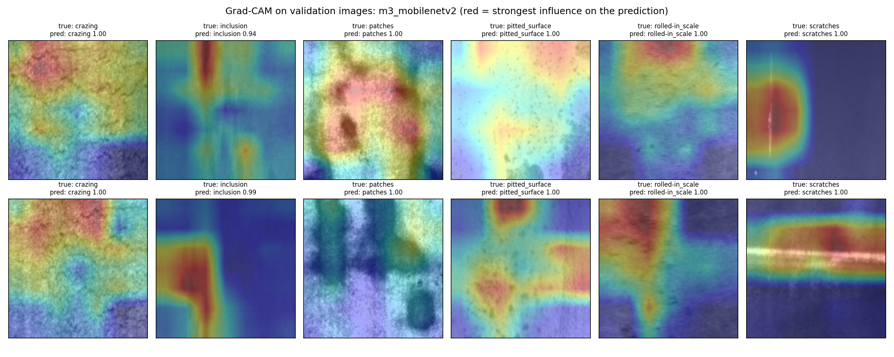

*Figure 8. Grad-CAM heatmaps of M3 on two validation images per class. The bright regions sit on the defects: the scratch line, the inclusion streak and the dark patches.*

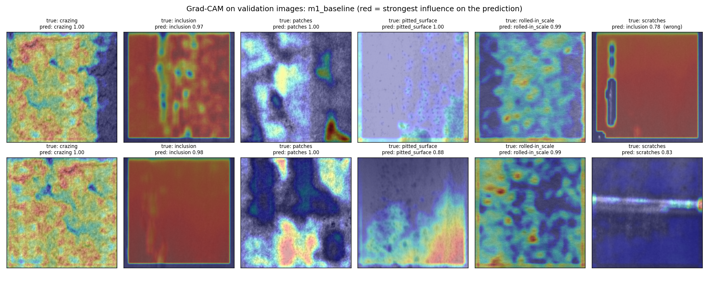

*Figure 9. Grad-CAM heatmaps of M1 on the same images. For inclusion, the flat steel around the defect lights up, and on a missed scratch the background is red and the scratch is not.*

M3's heatmaps sit on the defects, while M1's often sit on the background. EDA showed that inclusion images are among the flattest, so M1 has probably learned that a flat background means inclusion, a shortcut based on brightness and texture. That would fit the numbers, since M1 collapses when images are darkened or blurred and most of its test errors are pitted-surface images. It remains our interpretation of the heatmaps, and we did not test it with a separate experiment.

#### What the models get wrong

Figure 10 shows the confusion matrix of M3. Three of its four mistakes are faint scratches called inclusion, which is understandable, since a thin line along the rolling direction looks much like a long inclusion. The fourth is a rolled-in scale image called pitted surface. M1 made 16 mistakes. Ten of them are pitted-surface images (pitted surface recall 77.78%), labelled as inclusion (6), scratches (3) or rolled-in scale (1), and nine of those ten came with a confidence below 0.7. M1's recall on scratches is 88.89%, with 4 errors called inclusion. Our sources expected rolled-in scale and crazing to be confused [4], yet neither finalist mixed them up on the test set.

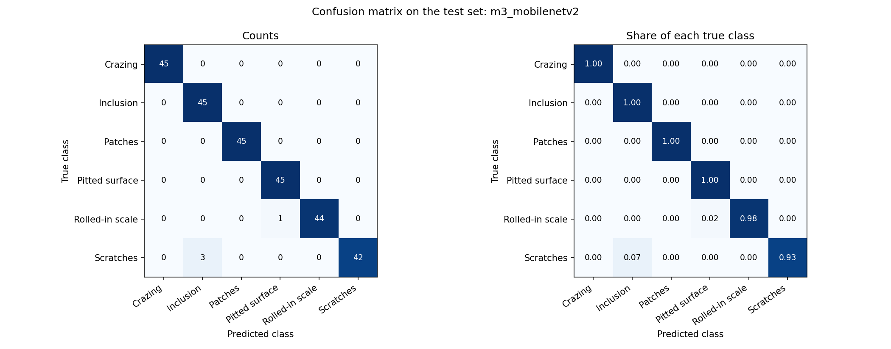

*Figure 10. Confusion matrix of M3 on the test set. Rows are true classes and columns are predicted classes. Counts are on the left and row-normalised shares on the right.*

#### Two batch-normalisation bugs

Both bugs showed up only in the validation results.

The first was in M2. In our first run it scored exactly 16.67% on validation in every epoch. That is one in six, which is what a model gets when it outputs the same class for every image. Its training accuracy meanwhile rose from 49.5% to 88.5%, so only the validation side was broken. Reading the batch-normalisation statistics from the saved model explained why. Batch normalisation uses each batch's own statistics in training and running averages at prediction time, and Keras moves those averages with a momentum of 0.99, only 1% per step. With 40 batches per epoch they lagged far behind. In the first layer the running variance was about 0.67 in every channel, while the real variance of those activations is about 0.01, so every validation image was normalised wrongly. With the momentum set to 0.9 the averages caught up within an epoch, and M2 reached 95.19% in the check run and 95.93% in the final run.

The second bug hit the fine-tuning of M3. Our first try unfroze the top 30 layers at a learning rate of 1e-5 and reached 88.89%. A second try from layer 100 at 1e-4 did worse, 81.11% at its best epoch, with validation accuracy jumping between 50% and 80%. In both tries training accuracy dropped at the first fine-tuning epoch (from 0.90 to 0.51 in the first), although a learning rate that small barely moves the weights. Batch normalisation was again the cause. Once unfrozen, the base's layers normalised with the statistics of each steel batch instead of the ImageNet ones, even with the base called as `training=False`. In Keras 3 the fix that worked was to keep every batch-normalisation layer frozen. The third try (layer 100, 1e-4, batch normalisation frozen) reached 97.41% in the check run and 97.04% in the final run. GPU fine-tuning is not exactly repeatable, so we report the final run and keep the failed runs in the repository. Since three recipes were tried on the validation set, M3's validation score has had slightly more tuning than M1's.

### 3.6 Ablation

To see what augmentation is worth, we retrained the M2 network three times with only the augmentation changed and scored each version on the validation set.

*Table 8. Augmentation ablation (M2 network, validation set).*

| Augmentation | Val. accuracy | Val. loss | Epochs trained |
|---|---|---|---|
| None | 100.00% | 0.0147 | 91 |
| No rotation (flips, zoom, contrast, brightness) | 99.26% | 0.0558 | 45 |
| Full (as in M2) | 95.56% | 0.1677 | 38 |

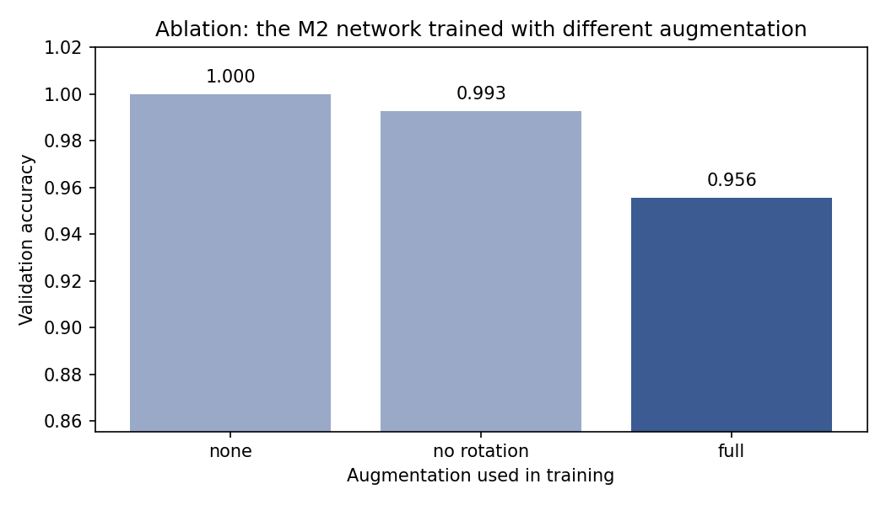

*Figure 11. Validation accuracy and loss of the M2 network with no augmentation, no rotation and the full set.*

On clean NEU images augmentation costs accuracy, and rotation costs the most. We expected this, because scratches and rolled-in scale follow the rolling direction and a rotated image is less realistic. An earlier run of the same notebook gave the same order (100.00%, 98.89%, 94.07%), with different exact numbers since GPU training is not exactly repeatable. For the same reason the full-augmentation retrain (95.56%) differs slightly from M2 in Table 4 (95.93%).

Table 6 shows the other side of the trade-off. Augmentation is what keeps M2 working when the lighting changes, and on a real line the lighting will change. The best clean score, 100% on validation, came from the network without augmentation. It was never run on the test set, which had already been used, and a perfect score on a validation set that informed several decisions should not be taken at face value.

### 3.7 Discussion

A pretrained network helps with small data, provided it is fine-tuned carefully. Frozen ImageNet features reached 81.11% on validation, and fine-tuning with batch normalisation frozen took M3 to 97.04% on validation and 98.52% on test. Our own small CNN reached 94.07% on test with about 20 times fewer parameters. Whether the bigger model is worth it depends on the device: M3 takes 223.96 ms per image on Kaggle's CPU before quantisation and 18.03 ms after.

Validation could not separate M1 from M3 (both 97.04%), and it put M1 above M2 where the test set did the opposite. With 270 images per set one image is worth 0.37 points, which is too coarse for models this close. We chose the finalists on validation loss and left them alone after seeing the test, even though that left M1 looking worse than M2. This data cannot give a reliable ranking of M1 and M2.

High accuracy on its own does not show that a model has learned the defect. M1 and M3 both scored 97.04% on clean validation images, yet Grad-CAM and the robustness test show M1 leaning on the background and breaking under small changes in brightness, blur or noise. In a plant, where lighting changes and lenses get dirty, that difference matters more than the 4 points of test accuracy between the two models.

Crack recall was 100% for all three models on the 45 crazing test images, and M3 raised no false alarm. That is encouraging, but it rests on 45 images from one lab-style dataset and says little about how often a crack would be missed on a real line.

#### Limitations

NEU is clean, balanced, lab-style data, which explains much of the high accuracy. Its images are small 200 x 200 patches, and we did not build the tiling step that long images from a line camera would need. We used one dataset and one split, trained each model once (so there is no spread across seeds) and timed the models on Kaggle's CPU instead of an edge device. Noise at a standard deviation of 0.10 breaks every model, and the trend view over time was never built. A real plant would need its own labelled images.

## 4. Conclusion

We built and evaluated a CNN-based recogniser for six steel surface defects, with crazing as the crack class, using the public NEU database in a Tata Steel scenario. Three CNNs were compared: a small CNN of our own (M1), the same CNN with batch normalisation and augmentation (M2) and a fine-tuned MobileNetV2 (M3).

On a test set opened once, M3 reached 98.52% accuracy and a macro F1 of 0.9852 with 4 errors in 270 images, and it found all 45 crazing images without a false crack alarm. M1 reached 94.07% and M2 96.67%. M1 and M3 had tied at 97.04% on validation, and the test set reversed the validation order of M1 and M2. We kept the finalists chosen in advance.

The extra experiments make the picture more cautious than the accuracy alone. Grad-CAM showed M3 looking at the defect and M1 often at the background. On damaged validation images M3 lost accuracy gradually under blur, darkening and low contrast while M1 fell quickly, and noise at a standard deviation of 0.10 broke every model. Augmentation lowered clean accuracy, most of all through rotation, and kept the model stable under lighting changes. TensorFlow Lite cut M3 from 24.46 MB to 2.51 MB and its CPU time to 18.03 ms per image.

Along the way we found and fixed two batch-normalisation bugs that would have made two of the models look much worse than they are. All results come from clean benchmark data. The method works on NEU, and whether it works on a production line is still an open question.

## 5. Future Work Plan

1. Test on other steel defect datasets and, if possible, on images from a real line, to see whether the results carry over.
2. Cut long high-resolution line-camera images into tiles the size of the NEU images and classify each tile, which is how a real system would use the model.
3. Add noise to the augmentation. None of our augmentations adds noise, and noise at a standard deviation of 0.10 broke every model.
4. Train each model several times and report the mean and spread. GPU training is not exactly repeatable, and one image is worth 0.37 points on our 270-image sets.
5. Collect more crack images for testing, since 45 crazing test images are too few to show that crack recall is reliably high.
6. Measure the TensorFlow Lite models on a small board next to the line and try full integer quantisation.
7. Count defect types over time and check whether a rising count points to the right equipment. This needs timestamped data, which NEU does not have.
8. Build a simple demo app that takes an image and shows the predicted class with a Grad-CAM overlay.

## References

[1] ispatguru, "Rolling of steel in hot strip mill." Available at: https://www.ispatguru.com/rolling-of-steel-in-hot-strip-mill/

[2] Steel Technology, "Rolling Mill Defects, Process Control, and Quality Improvement." Available at: https://www.steel-technology.com/articles/rolling-defects-process-control-steel-quality

[3] "Classification of Surface Defects in Steel Sheets Using Developed NasNet-Mobile CNN and Few Samples," Revue d'Intelligence Artificielle, vol. 38, no. 2. Available at: https://www.iieta.org/journals/ria/paper/10.18280/ria.380232

[4] A. Maity and T. Ghosh, "Comparative Analysis of Object Detection Algorithms for Surface Defect Detection," arXiv:2510.21811, 2025.

[5] Vision Systems Design, "Linescan cameras inspect steel." Available at: https://www.vision-systems.com/factory/article/16736748/linescan-cameras-inspect-steel

[6] ABM Proceedings, "Hot rolling surface quality issues" (abstract only). Available at: https://abmproceedings.com.br/en/article/download-pdf/hot-rolling-surface-quality-issues-4

[7] K. Song and Y. Yan, "A noise robust method based on completed local binary patterns for hot-rolled steel strip surface defects," Applied Surface Science, vol. 285, pp. 858 to 864, 2013. The class list and image counts were taken from the NEU entry in awesome-industrial-datasets: https://github.com/jonathanwvd/awesome-industrial-datasets/blob/master/markdown/neu_surface_defect_dataset.md

[8] NEU Surface Defect Database (Kaggle mirror, NEU-DET layout). Available at: https://www.kaggle.com/datasets/kaustubhdikshit/neu-surface-defect-database

[9] M. Sandler, A. Howard, M. Zhu, A. Zhmoginov and L.-C. Chen, "MobileNetV2: Inverted Residuals and Linear Bottlenecks," in Proc. IEEE/CVF Conference on Computer Vision and Pattern Recognition (CVPR), 2018, pp. 4510 to 4520.

[10] Keras, "Transfer learning and fine-tuning" (guide). Available at: https://keras.io/guides/transfer_learning/

[11] R. R. Selvaraju, M. Cogswell, A. Das, R. Vedantam, D. Parikh and D. Batra, "Grad-CAM: Visual Explanations from Deep Networks via Gradient-based Localization," in Proc. IEEE International Conference on Computer Vision (ICCV), 2017.

[12] AI for Engineers EST Project, project repository (notebooks, results, report). Available at: https://github.com/ArnavCodez/Ai-for-engineers-EST-project
